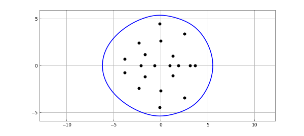
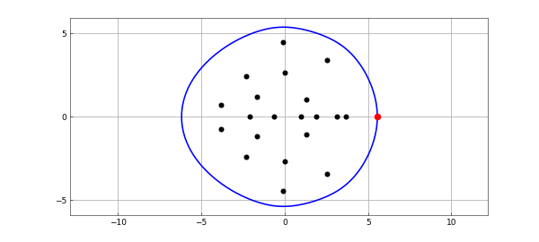
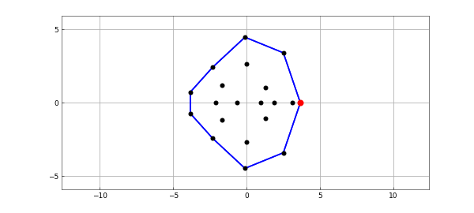
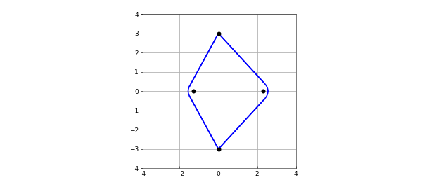

# Field of values and numerical abscissa

*Nick Trefethen, November 2010*

[Original MATLAB Chebfun example](https://www.chebfun.org/examples/linalg/FieldOfValues.html)

Python translation: [`examples/linalg/field_of_values.py`](https://github.com/ma-gilles/chebfunjax/blob/main/examples/linalg/field_of_values.py)

If A is a matrix, the field of values F(A) is the nonempty bounded convex set in the complex plane consisting of all the Rayleigh quotients of A, that is, all the numbers q'Aq, where q is a unit vector and q' is its conjugate transpose.

The standard method for computing the field of values numerically is an algorithm due to C. R. Johnson in 1978 based on finding the maximum and minimum eigenvalues of (A+A')/2, then "rotating" this computation around in the complex plane [1]. This algorithm is implemented in the Chebfun command FOV, which is listed at the end of this Example.

Generically the boundary of the field of values is smooth, but it is not always smooth. Chebfun's 'splitting' feature enables FOV to compute this boundary in either situation, smooth or not.

For example, here are the eigenvalues and field of values of a random matrix of dimension 20. This is a case where the boundary is smooth.

```matlab
rng(1), A = randn(20);
LW = 'linewidth'; lw = 1.6; MS = 'markersize'; ms = 18;
FA = fov(A);
figure, plot(FA,LW,lw), axis equal, grid on
ax = axis; axis(1.1*ax)
hold on, plot(eig(A),'.k',MS,ms)
```



The numerical abscissa of A is the maximum real part of its field of values:

```matlab
[alpha,maxtheta] = max(real(FA))
```

```text
alpha =
   5.556701165271412
maxtheta =
     0
```

Here we add it to the plot as a red dot:

```matlab
plot(real(FA(maxtheta)),imag(FA(maxtheta)),'.r',MS,24)
```



You can also find the numerical abscissa without Chebfun:

```matlab
alpha = max(eig((A+A')/2))
```

```text
alpha =
   5.556701165271407
```

Now let's consider a matrix B defined as a diagonal matrix with the same eigenvalues as A. In this case the boundary of the field of values is a polygon:

```matlab
B = diag(eig(A));
FB = fov(B);
hold off, plot(real(FB),imag(FB),'b',LW,lw,'jumpline',{'b',LW,lw})
hold on, plot(eig(B),'.k',MS,ms), axis(1.1*ax), axis equal, grid on
[alpha,maxtheta] = max(real(FB));
plot(real(FB(maxtheta)),imag(FB(maxtheta)),'.r',MS,24)
```



Since the field of values is not smooth, its boundary is a chebfun with several pieces:

```matlab
FB
```

```text
FB =
   chebfun column (10 smooth pieces)
       interval       length     endpoint values
[       0,    0.33]        1       3.7      3.7
[    0.33,     1.2]        1     complex values
[     1.2,     2.3]        1     complex values
[     2.3,     2.4]        1     complex values
[     2.4,     3.1]        1     complex values
[     3.1,     3.9]        1     complex values
[     3.9,       4]        1     complex values
[       4,     5.1]        1     complex values
[     5.1,       6]        1     complex values
[       6,     6.3]        1       3.7      3.7
vertical scale = 4.5    Total length = 10
```

Finally, here's an example where the boundary of the field of values mixes smooth curves with straight segments:

```matlab
C = [0 3 0 0; -3 0 0 0; 0 0 0 3; 0 0 1 1]
FC = fov(C);
hold off, plot(real(FC),imag(FC),'b',LW,lw,'jumpline',{'b',LW,lw})
axis(4*[-1 1 -1 1]), axis square, grid on
hold on, plot(eig(C),'.k',MS,ms)
```

```text
C =
     0     3     0     0
    -3     0     0     0
     0     0     0     3
     0     0     1     1
```



Here is a listing of FOV. Note that the numerical computations are carried out in just about 10 lines of code.

```matlab
type fov
```

```text
"""Field of values (numerical range) of a matrix as a complex Chebfun.

``fov(A)`` returns the boundary curve of the field of values of ``A`` as a
complex-valued Chebfun of the Johnson angle ``theta`` on ``[0, 2*pi]``,
constructed with splitting on (the curve of a non-normal matrix has
corners and, when the numerical range has flat sides, jumps) and merged;
``fov(A, line_segments=True)`` also returns the straight line segments
that close the jumps and the angles at which they occur.

Provenance
----------
MATLAB source : fov.m
Chebfun commit: 7574c77
Original authors: Copyright 2017 by The University of Oxford and The
    Chebfun Developers.
"""

from __future__ import annotations

import jax
import jax.numpy as jnp

from chebfunjax.chebfun1d.chebfun import Chebfun, chebfun

@jax.jit
def _fov_curve(theta, A):
    """Literal Johnson Rayleigh quotient, mapped serially over angles."""
    th = jnp.atleast_1d(theta)

    def point(t):
        B = jnp.exp(1j * t) * A
        H = (B + B.conj().T) / 2
        w, X = jnp.linalg.eigh(H, symmetrize_input=False)
        v = X[:, jnp.argmax(w)]
        return ((v.conj() @ A) @ v) / (v.conj() @ v)

    # Native source processes one angle at a time. A mapped loop also avoids
    # materializing a large stack of eigensystems during adaptive refinement.
    return jax.lax.map(point, th.reshape(-1)).reshape(th.shape)

def fov(A, line_segments: bool = False, *, pref=None):
    """Field of values boundary of the matrix ``A`` (MATLAB ``fov``).

    Parameters
    ----------
    A : array_like, shape (n, n)
    pref : optional
        Constructor preferences; domain and splitting follow native FOV overrides.
    line_segments : bool
        If True return ``(f, lineSegs, theta)`` like MATLAB's three-output
        form. The Python adapter returns ``lineSegs`` as a list of scalar
        Chebfuns on [-1, 1], each joining the left and right limits of
        ``f`` at a jump; ``theta`` contains the angles of those jumps.

    Provenance
    ----------
    MATLAB source : fov.m
    Chebfun commit: 7574c77
    """
    A = jnp.atleast_2d(jnp.asarray(A))
    f = chebfun(lambda t: _fov_curve(t, A), pref=pref,
                domain=(0.0, 2.0 * jnp.pi), splitting=True)
    f = f.merge()
    if not line_segments:
        return f
    ends = jnp.asarray(list(f.domain.breakpoints), dtype=jnp.float64)
    delta = 1e-14
    if jnp.any(jnp.diff(ends) < delta):
        delta = float(jnp.min(jnp.diff(ends))) / 3
    left = jnp.asarray(f(jnp.asarray(ends[:-1]), "left")).ravel().astype(jnp.complex128)
    left = left.at[0].set(jnp.asarray(f(ends[-1], "left")).reshape(()))
    right = jnp.asarray(f(jnp.asarray(ends[:-1]), "right")).ravel().astype(jnp.complex128)
    tol = 10 * delta * jnp.maximum(jnp.abs(left), jnp.abs(right))
    discont = jnp.abs(left - right) > tol
    theta = ends[:-1][discont]
    cols = [Chebfun.from_values(jnp.asarray([lv, rv]), domain=(-1.0, 1.0))
            for lv, rv in zip(left[discont], right[discont])]
    return f, cols, theta
```

## References

1. C. R. Johnson, Numerical determination of the field of values of a general complex matrix, *SIAM Journal on Numerical Analysis*, 15 (1978), 595-602.
2. L. N. Trefethen and M. Embree, *Spectra and Pseudospectra: The Behavior of Nonnormal Matrices and Operators*, Princeton U. Press, 2005, chapter 17 on Numerical range, abscissa, and radius.

---

*Translated with [chebfunjax](https://github.com/ma-gilles/chebfunjax); prose and MATLAB code from the original example, copyright The University of Oxford and The Chebfun Developers.  Printed outputs and figures are chebfunjax's.*
