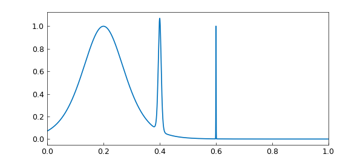
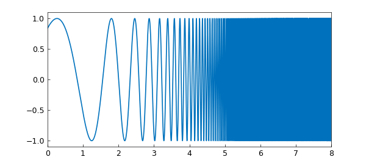
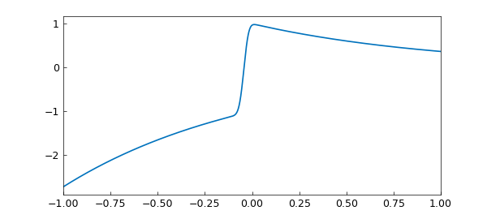
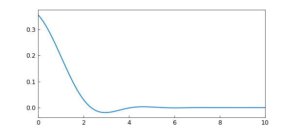
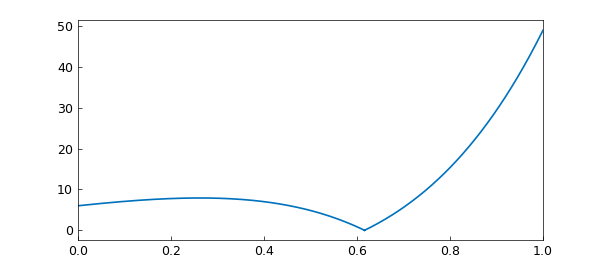
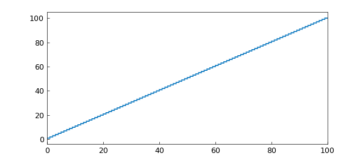
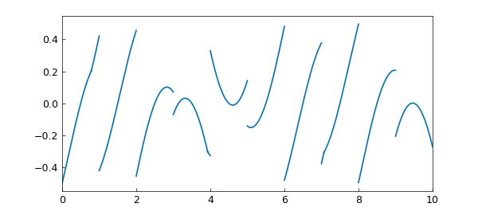
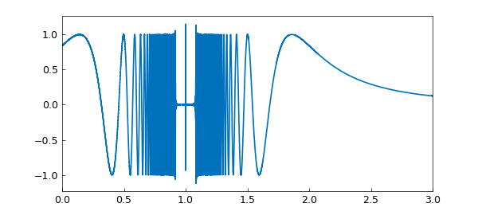
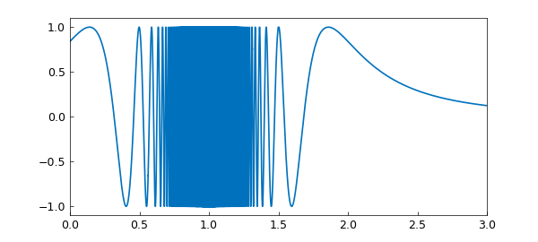

# Some tricky integrals

*Fredrik Johansson and Nick Trefethen, March 2018*

[Original MATLAB Chebfun example](https://www.chebfun.org/examples/quad/Tricky.html)

Python translation: [`examples/quad/tricky.py`](https://github.com/ma-gilles/chebfunjax/blob/main/examples/quad/tricky.py)

> Execution qualification (2026-10-17): Airy output blocks 6 and 7 and figure 4 come from a separate completed CPU execution of those current source cells using the JAX Airy primitive. The unbounded integral is now finite; both displayed integrals match the historical native displays. The ten other output blocks and eight other figures retain the earlier completed full-script capture; their scientific source statements are unchanged. Pinned JAX/JAXlib 0.11.0 was used for both runs. The intentional unresolved approximation and its `Function not resolved using 6091 pts.` warning remain. Axis limits, ticks, fonts and raster differences remain; pixel parity is not claimed. See [`tricky_airy_jax_cpu_20261017.json`](../../tricky_airy_jax_cpu_20261017.json) and the [earlier full-run receipt](../../tricky_full_current_cpu_20261017.json).

## 0. Introduction

FJ gave a talk at ENS Lyon today with a number of examples in it that intrigued LNT. Here we play with some of those examples in Chebfun. Now Chebfun is just numerical, with no guarantees of accuracy, which means it is not a competitor for FJ's Arb method of rigorous quadrature [1]. The point of this example is only to see how Chebfun does, unrigorously in floating point arithmetic, on some challenging examples people have cooked up over the years.

We find that in all but one of these examples, Chebfun very nicely gets a highly accurate answer. Example 3, however, shows difficulties with a function with a lot of discontinuities.

## 1. Three spikes

This problem comes from R. Cranley and T. N. L. Patterson, On the automatic numerical evaluation of definite integrals, The Computer Journal 14 (1971), 189-198. It also appeared in D. K. Kahaner, Comparison of numerical quadrature formulas, in J. R. Rice, ed., Mathematical Software, Academic Press, 1971, 229-259. See also the earlier Chebfun example www.chebfun.org/examples/quad/SpikeIntegral.html.

```matlab
format long
ff = @(x) 1/cosh(10*(x-.2))^2 + 1/cosh(100*(x-.4))^4 + 1/cosh(1000*(x-.6))^6;
Iexact = 0.210802735500549277
tic, f = chebfun(ff,[0 1]), I = sum(f); toc
plot(f)
```

```text
Iexact =
   0.210802735500549
f =
   chebfun column (1 smooth piece)
       interval       length     endpoint values
[       0,       1]    14128     0.071  4.5e-07
vertical scale = 1.1
Elapsed time is 14.219207 seconds.
```



Note that turning on splitting doesn't make much difference to speed.

```matlab
tic, f = chebfun(ff,[0 1],'splitting','on'), I = sum(f); toc
```

```text
f =
   chebfun column (6 smooth pieces)
       interval       length     endpoint values
[       0,    0.38]       75     0.071     0.11
[    0.38,    0.44]       87      0.11    0.034
[    0.44,    0.59]       42     0.034   0.0015
[    0.59,     0.6]       97    0.0015   0.0055
[     0.6,    0.62]       76    0.0055  0.00081
[    0.62,       1]       23   0.00081  4.5e-07
vertical scale = 1.1    Total length = 400
Elapsed time is 33.956552 seconds.
```

## 2. Violent oscillation

This problem comes from S. M. Rump, Verification methods: rigorous results using floating-point arithmetic, Acta Numerica, 19 (2010), 287-449. It is also discussed in W. Tucker, Validated Numerics: A Short Introduction to Rigorous Computations, Princeton U. Press, 2011.

```matlab
ff = @(x) sin(x+exp(x));
Iexact = 0.34740017265724780787
tic, f = chebfun(ff,[0 8]), I = sum(f), toc
plot(f)
```

```text
Iexact =
   0.347400172657248
f =
   chebfun column (1 smooth piece)
       interval       length     endpoint values
[       0,       8]     3796      0.84    -0.96
vertical scale =   1
I =
   0.347400172657248
Elapsed time is 1.448628 seconds.
```



## 3. Violent oscillation with 2979 discontinuities

If we try this with default parameters, we get a warning related to Chebfun's default preference values splitMaxLength = 6000.

```matlab
ff = @(x) (exp(x)-floor(exp(x)))*sin(x+exp(x));
Iexact = 0.098651704478365206119
tic, f = chebfun(ff,[0 8],'splitting','on'); I = sum(f), toc
```

```text
Iexact =
   0.098651704478365
I =
   0.087881488553783
Elapsed time is 10.556709 seconds.
```

By increasing splitMaxLength greatly, we can get an answer but it's outrageously slow *and* it's only accurate to 6 digits. Specifically, the commands

I = sum(chebfun(ff,[0 8],'splitting','on','splitMaxLength',1e6))give the result I = 0.0986522613... after 72 seconds. We are well aware that Chebfun is slow for problems with many discontinuities, but for it to lose ten digits of accuracy looks like a bug somewhere. (I have confirmed by adding up the pieces by hand that the ``exact'' answer is correct.)

It would be good to investigate why this integral is giving such trouble.

## 4. Error function

This problem comes from Silviu Filip.

```matlab
ff = @(x) exp(-x)*erf(sqrt(1250)*x+1.5);
Iexact = NaN
tic, f = chebfun(ff), I = sum(f), toc
plot(f)
```

```text
Iexact =
   NaN
f =
   chebfun column (1 smooth piece)
       interval       length     endpoint values
[      -1,       1]      393      -2.7     0.37
vertical scale = 2.7
I =
  -0.999065350291923
Elapsed time is 1.462648 seconds.
```



## 5. Airy function

This problem comes from FJ.

```matlab
ff = @(x) exp(-x)*airy(-x);
Iexact = 0.378751605379086535
tic, f = chebfun(ff,[0 inf]), I = sum(f), toc
plot(f)
```

```text
Iexact =
   0.378751605379087
f =
   chebfun column (1 smooth piece)
       interval       length     endpoint values
[       0,     Inf]      415      0.36  8.8e-16
vertical scale = 0.36
I =
   0.378751605379086
Elapsed time is 21.250295 seconds.
```



We compare this with the result on a sufficiently large finite interval:

```matlab
tic, f = chebfun(ff,[0 40]), I = sum(f), toc
```

```text
f =
   chebfun column (1 smooth piece)
       interval       length     endpoint values
[       0,      40]      121      0.36 -6.9e-18
vertical scale = 0.36
I =
   0.378751605379087
Elapsed time is 1.378714 seconds.
```

## 6. Absolute value of polynomial

This problem was posed by Harald Helfgott on MathOverflow, [https://mathoverflow.net/questions/123677/rigorous-numerical-integration](https://mathoverflow.net/questions/123677/rigorous-numerical-integration). See also A. Mahboubi, G. Melquiond, and T. Sibut-Pinote, Formally verified approximations of definite integrals, International Conference on Interactive Theorem Proving, Spring, 2016, 274-289.

```matlab
ff = @(x) abs(x^4+10*x^3+19*x^2-6*x-6)*exp(x);
Iexact = 11.1473105500571397339
tic, f = chebfun(ff,[0 1],'splitting','on'), I = sum(f), toc
plot(f)
```

```text
Iexact =
  11.147310550057140
f =
   chebfun column (2 smooth pieces)
       interval       length     endpoint values
[       0,    0.62]       13         6  9.8e-15
[    0.62,       1]       12   5.4e-15       49
vertical scale =  49    Total length = 25
I =
  11.147310550057142
Elapsed time is 4.251475 seconds.
```



## 7. A ceiling function

This is an integral representation of the triangular sum that Gauss famously figured out as a schoolboy. See B. Hayes, Gauss's day of reckoning, American Scientist 94 (2006), 200-205.

```matlab
ff = @(x) ceil(x);
Iexact = 5050
tic, f = chebfun(ff,[0 100],'splitting','on'); I = sum(f), toc
plot(f)
```

```text
Iexact =
        5050
I =
        5050
Elapsed time is 8.932107 seconds.
```



## 8. Another non-smooth function

```matlab
ff = @(x) (x-floor(x)-1/2)*max(sin(x),cos(x));
Iexact = -0.14281864202632808376
tic, f = chebfun(ff,[0 10],'splitting','on'); I = sum(f), toc
plot(f)
```

```text
Iexact =
  -0.142818642026328
I =
  -0.142818642026329
Elapsed time is 8.885599 seconds.
```



## 9. From Brisebarre and Joldes

This example comes from Mioara Joldes, Rigorous Polynomial Approximations and Applications, PhD thesis, ENS Lyon, 2011. The source of the integral is C.-Y. Chen, Computing interval enclosures for definite integrals by application of triple adaptive strategies, Computing, 78 (2006), 81-99. It requires a Chebfun of length more than a million.

```matlab
ff = @(x) sin((0.001+(1-x)^2)^(-3/2));
Iexact = 0.74997436852719477011
tic, f = chebfun(ff,[0 3],'maxLength',1e7), I = sum(f), toc
plot(f)
```

```text
Iexact =
   0.749974368527195
f =
   chebfun column (1 smooth piece)
       interval       length     endpoint values
[       0,       3]   1239813      0.84     0.12
vertical scale =   1
I =
   0.749974368527190
Elapsed time is 12.854563 seconds.
```



It is interesting to note the near-zero region near x=1 here. That's incorrect, but has negligible effect on the integral.

Splitting on is hard work too, but at least it eventually gets the right answer, and this time with a more convincing plot.

```matlab
tic, f = chebfun(ff,[0 3],'splitting','on','splitMaxLength',1e6);
I = sum(f), toc
plot(f)
```

```text
I =
   0.749974368527185
Elapsed time is 116.876490 seconds.
```



## Reference

Not much has been done on rigorous extended precision arithmetic, but FJ's Arb library is a contribution in this area:

[1] F. Johansson, Numerical integration in arbitrary-precision ball arithmetic, arXiv:1802.07942 and *International Congress on Mathematical Software*, Springer, Cham, 2018.

---

*Translated with [chebfunjax](https://github.com/ma-gilles/chebfunjax); prose and MATLAB code from the original example, copyright The University of Oxford and The Chebfun Developers.  Printed outputs and figures are chebfunjax's.*
